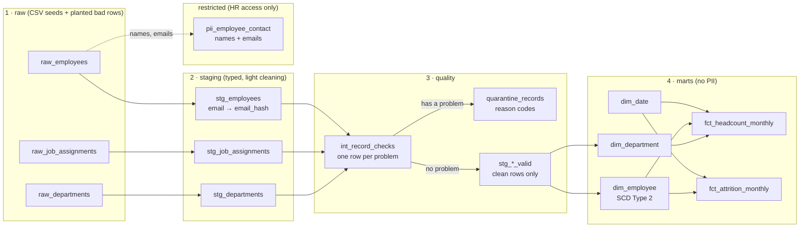
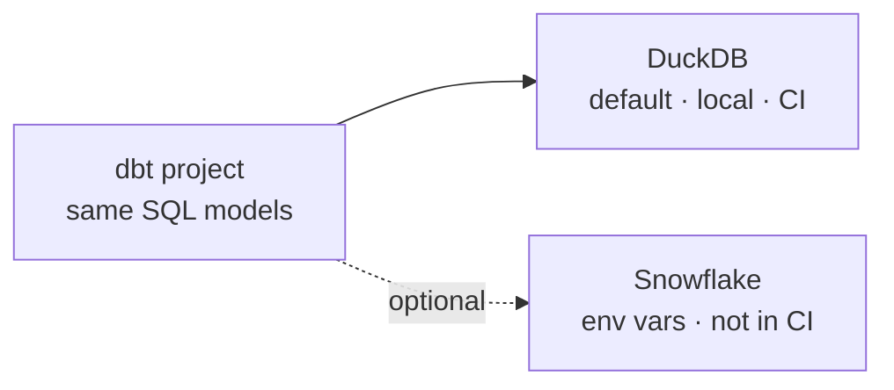

# people-analytics-dbt

**Workforce data that doesn't lie.**

<!-- CI badge goes here in Stage 4 (repo: RamfisOrtega/people-analytics-dbt) -->

> All data in this project is synthetic (made up). No real people or companies.

## Goals

This project shows how to turn messy HR data into numbers you can trust.

- **Effective-dated records.** Every job change has a start date and an end date.
- **SCD Type 2 employee dimension.** It keeps the full history of each employee, one row per version.
- **Point-in-time headcount.** How many people worked here on any given date?
- **Monthly attrition.** How many people left each month, and was it voluntary or not?
- **Data quality with quarantine.** Bad rows are not deleted. They go to a quarantine table with a reason code.
- **PII handling.** Names and emails are kept out of the reporting tables.

Where it runs:

- **DuckDB (default).** Local, free, no account needed. CI uses this.
- **Snowflake (optional).** The same dbt models, set up through environment variables. Documented, not tested in CI.

## The problem

_TODO (Stage 4)._

## Architecture

How data flows, left to right:



How to read it:

- **Solid arrows** show the main data flow.
- **The dotted arrow** shows where personal data goes: only to the restricted schema.
- **Every raw row ends up in one place:** either in a `stg_*_valid` model or in `quarantine_records`. Never lost.

Where the same dbt project runs:



## Quickstart

_TODO (Stage 4): 5 commands, PowerShell and bash._

## Data model

_TODO (Stage 4)._

## Data-quality design

_TODO (Stage 4): reason codes and the reconciliation rule._

## Metric definitions

### Headcount (point in time)

_TODO (Stage 4)._

### Attrition

_TODO (Stage 4)._

## PII handling

_TODO (Stage 4)._

## How to run the tests

_TODO (Stage 4)._

## Run on Snowflake (optional, not tested in CI)

The same models run on Snowflake. Only the connection changes.

> Status: set up, **not yet run on a real Snowflake account.** This note changes once it has been tested.

**1. Install the Snowflake adapter** (venv active):

```
pip install dbt-snowflake
```

**2. Set your connection details as environment variables.** They are never stored in the repo.

PowerShell:
```
$env:SNOWFLAKE_ACCOUNT   = "your-account"
$env:SNOWFLAKE_USER      = "your-user"
$env:SNOWFLAKE_PASSWORD  = "your-password"
$env:SNOWFLAKE_ROLE      = "your-role"
$env:SNOWFLAKE_WAREHOUSE = "your-warehouse"
$env:SNOWFLAKE_DATABASE  = "your-database"
```

bash:
```
export SNOWFLAKE_ACCOUNT="your-account"
export SNOWFLAKE_USER="your-user"
export SNOWFLAKE_PASSWORD="your-password"
export SNOWFLAKE_ROLE="your-role"
export SNOWFLAKE_WAREHOUSE="your-warehouse"
export SNOWFLAKE_DATABASE="your-database"
```

**3. Build** (from `dbt_project/`):

```
dbt build --target snowflake
```

What makes this portable:

- **Seeds use explicit `column_types`,** so both databases load the CSVs the same way.
- **The `hash_pii` macro** picks the right hash function: `sha256` on DuckDB, `sha2(..., 256)` on Snowflake.
- **Each layer has its own schema** (`raw`, `staging`, `quality`, `marts`, `restricted`). In Snowflake, access can be granted per schema. For example, only HR roles get `restricted`.

Your Snowflake account may need MFA or key-pair login instead of a password. If so, update the `snowflake` target in `profiles.yml`.

## Design decisions and trade-offs

_TODO (Stage 4)._

## Limitations and next steps

_TODO (Stage 4)._

## Synthetic data note

_TODO (Stage 4)._

## License

MIT. See [LICENSE](LICENSE).
